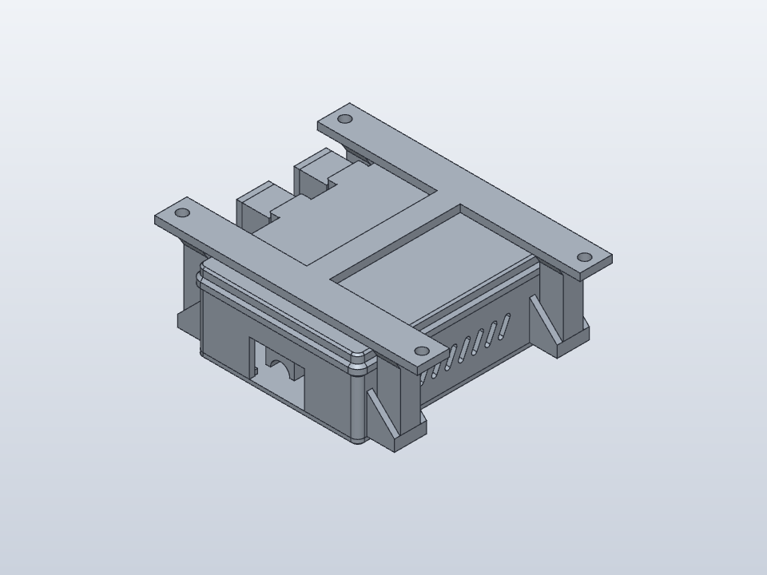
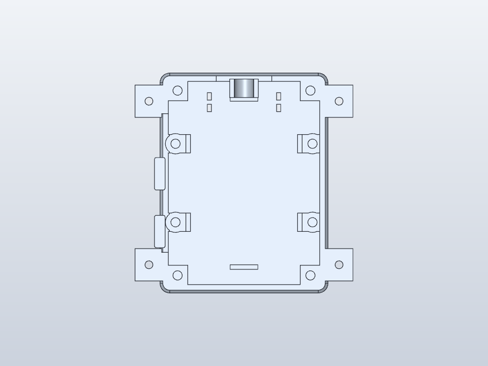
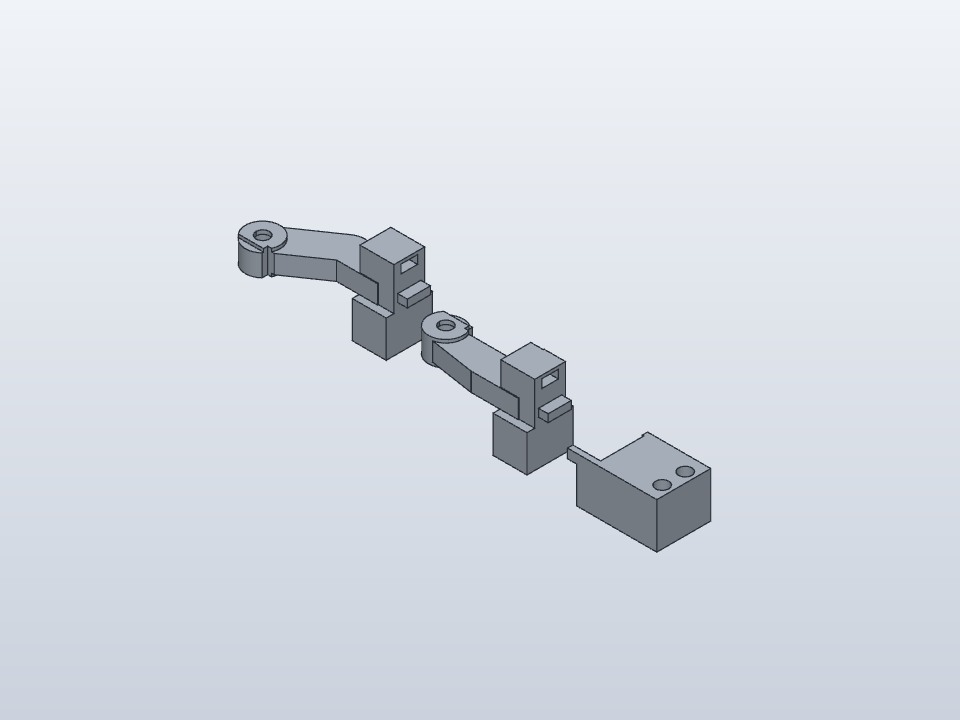

# ESP32 enclosure in SolidCraft

Open **[enclosure.solidcraft](revision-014/enclosure.solidcraft)** for the complete
revision 014 enclosure with 15 named bodies. Individual printable parts, the
board/button fit jig, and print layouts are included below.

This conversion preserves the current engineering geometry as **editable imported
solid features**. It does not recreate the original Python sketches, expressions
or parametric feature history. Add direct-edit and new modeling features in
SolidCraft; use the preserved [Python source](../revisions/014-usb-clearance/model.py)
and [parameters](../revisions/014-usb-clearance/parameters.json) when regenerating
the original dimension-driven design. No unused SolidCraft parameters are added.

The `.solidcraft` documents embed their source geometry and open without the
reference STEP files. Matching plain JSON documents are included for readable
git diffs and scripted edits. Treat those JSON documents as the source for
subsequent SolidCraft edits, then save an updated `.solidcraft` copy for opening
in the app. The existing Python revisions remain preserved.

## Open and print

| File | Purpose |
| --- | --- |
| [Enclosure](revision-014/enclosure.solidcraft) | Mounted assembly, 15 named bodies |
| [Assembly JSON](revision-014/enclosure.json) | Same SolidCraft document, readable source format |
| [Individual parts](revision-014/parts/) | 15 native documents, STEP and print-oriented 3MF files |
| [Full print layout](revision-014/print-layout.solidcraft) | All 15 parts in their production print orientation |
| [Full print 3MF](revision-014/print-layout.3mf) | Geometry for a slicer; split onto plates as needed |
| [Quick three-piece print](revision-014/fit-tests/replacements-only.3mf) | RESET slider, BOOT slider and BOOT frame |
| [Quick print SolidCraft document](revision-014/fit-tests/replacements-only.solidcraft) | Same three replacement pieces |
| [Complete fit jig](revision-014/fit-tests/assembly.solidcraft) | Board-registration frame, clamps and both cartridges, 13 bodies |
| [Complete fit print](revision-014/fit-tests/print-layout.3mf) | 13 pieces, for a fresh test setup |
| [Registration frame](revision-014/fit-tests/button_fit_frame.solidcraft) | Individual fit-frame document |







The full assembly document is for CAD inspection. Use the individual print files
or print layouts for slicing. All units are millimeters. These 3MFs contain
geometry rather than validated printer/filament/support settings. Body floor-down,
lid exterior-down and bracket desk-contact-face down remain the intended
orientations. Sliders need local removable supports beneath their elevated arms.
The conversion retains the existing frame orientations; the review's flipped-frame
candidate is not applied here.

Use the [existing test 009 checklist](../fit-tests/009-usb-clearance/README.md)
and [button assembly guide](../assembly-guides/014-buttons/README.md). Fit the
board, clamps and USB plug before top-loading the sliders into the frames.
The centered plug clears; board-position-limit contacts, 0.8 mm magnet-pocket
features, switch travel, magnetic return and actual print fit remain unresolved.
Those are inherited design issues, not changes introduced by this conversion.
The separate concave 8 mm cable seat and zip-tie passage are retained.

## Geometry checks

[validation.json](revision-014/validation.json) records exact STEP comparisons,
valid solids, units, body counts, watertight print meshes, and relocation/opening
of the native documents without reference files. Every pair uses a maximum
symmetric-difference volume of **0.001 mm³**. This tests the actual exported
geometry, not just matching total volumes.
[Print placement checks](revision-014/mesh-placement-validation.json) additionally
compare all three converted print layouts against the original published 3MFs.

[Frozen reference measurements](revision-014/manifest.json) come from the preserved
Python model and identify the original source hashes. [Regression tests](test_design.py)
check every document against those measurements. Imported features have no
SolidCraft driving parameters, so parameter-range walks and sketch-constraint
checks do not apply; timeline errors and warnings are still checked.

The conversion covers the current controller enclosure and its fit-print tools.
Earlier revisions are preserved as historical references. The separate lighting-node
F3D files still require Fusion exports before a comparable conversion.

## Rebuild or edit

SolidCraft CLI 0.16.2 was used. From `Models/ESP32Enclosure`, with the CLI on PATH:

```bash
uv sync --locked
uv run --locked python solidcraft/scripts/convert.py --output solidcraft/builds/revision014
uv run --locked python solidcraft/scripts/validate.py solidcraft/builds/revision014
uv run --locked python solidcraft/scripts/check_print_placements.py solidcraft/builds/revision014
uv run --locked python -m pytest -q solidcraft/test_design.py
```

The converter requires a fresh output directory and does not overwrite the
archived documents. It regenerates the original full/test models, creates named
STEP references, then runs the real SolidCraft importer/save/export commands.
The validator compares those exports both with named references and, where
available, the original archived STEP files. Tests target the published
`revision-014` documents; use the validator for a new build output.

To edit a document through a command script:

```bash
solidcraft-cli run edits.json --in solidcraft/revision-014/parts/body.json \
  --save solidcraft/builds/body-v2.json --out solidcraft/builds/body-v2.step
solidcraft-cli run --in solidcraft/builds/body-v2.json \
  --save solidcraft/builds/body-v2.solidcraft
```

Save edits to a new path first. For any geometry change, regenerate a small test
print from the same changed interfaces and check it before printing the full case.
