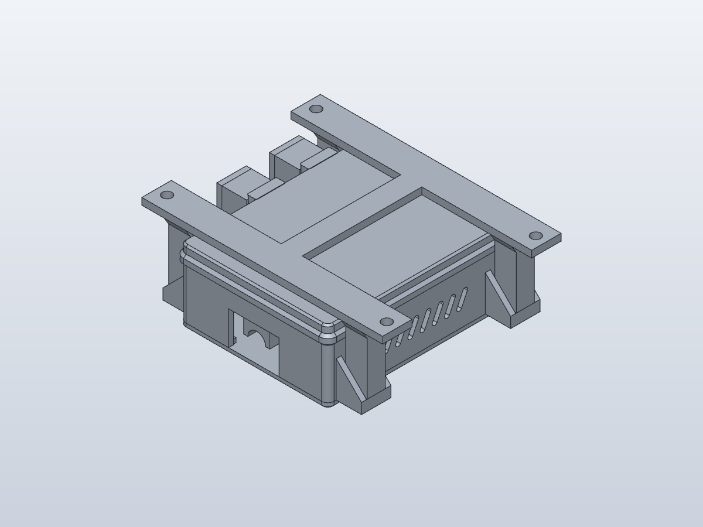
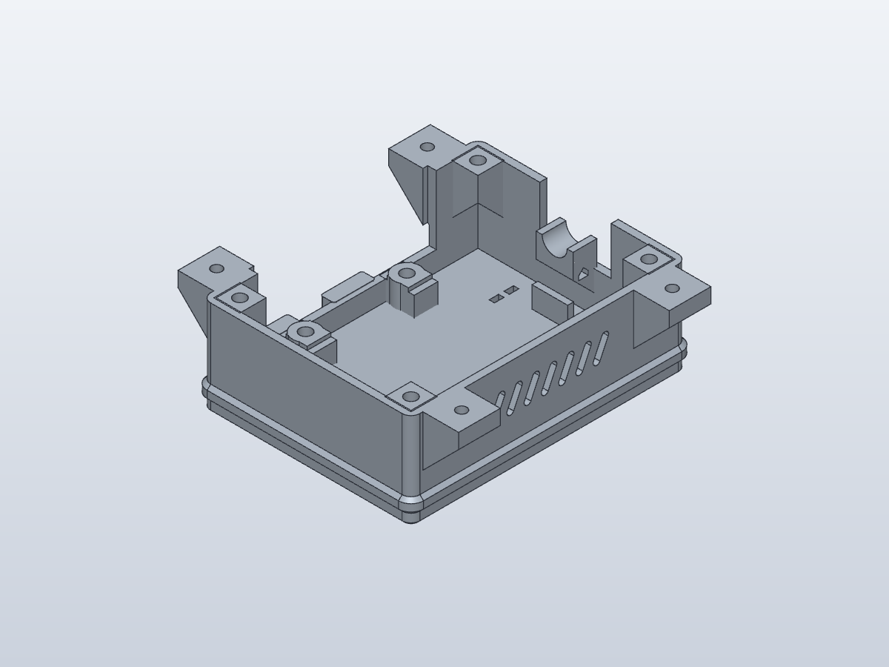
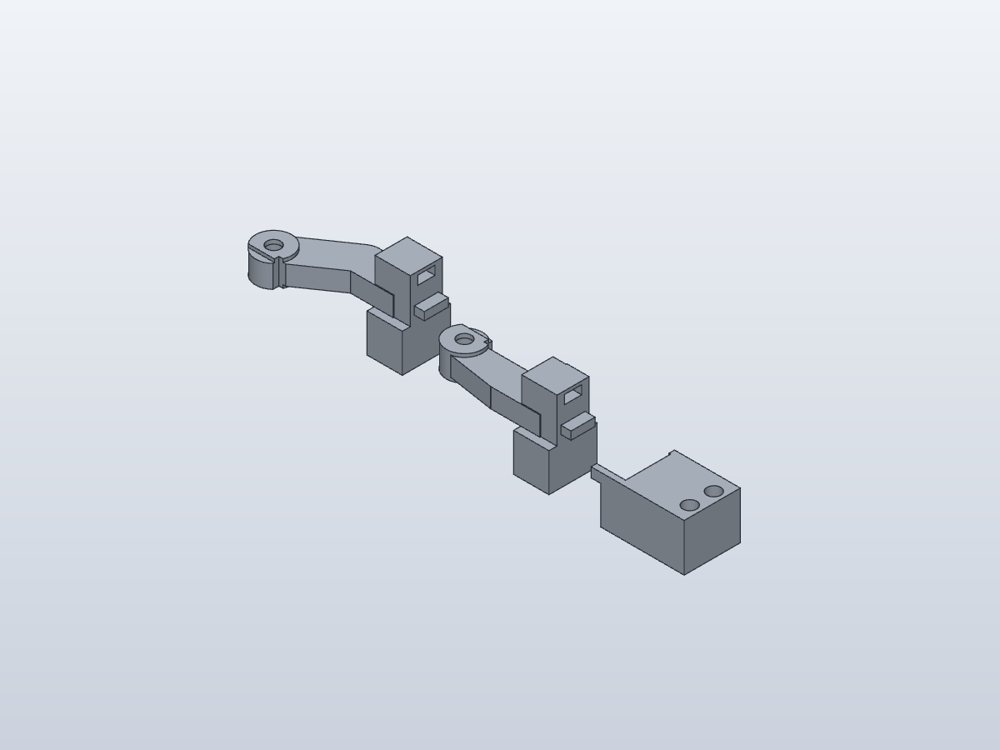

# Native parametric SolidCraft enclosure

**Latest: [revision 017 — full rectangular spherical cups](revision-017-rectangular-cups/README.md).**
The spherical surface spans the entire rectangular finger face, with 0.6 mm
nominal center depression. [Open revision 017](revision-017-rectangular-cups/enclosure.solidcraft),
[print the two sliders](revision-017-rectangular-cups/replacement-sliders.3mf), or
[compare small feel samples](revision-017-rectangular-cups/fit-tests/finger-cup-samples.3mf).
Print cup-side up and review supports beneath raised arms/bosses.
The workflow and frozen checks below describe the preserved revision-014 rebuild;
newer revisions have separate validation reports. Barrel-holder alignment remains paused.

Open **[enclosure.solidcraft](revision-014/enclosure.solidcraft)** for the mounted
revision 014 assembly, rebuilt from native sketches, dimensions and features.
The main document has 199 fully constrained sketches and no imported geometry.
The preserved Python revisions and [earlier imported conversion](../revision-014/)
remain available as references.

| File | Use |
| --- | --- |
| [Complete enclosure](revision-014/enclosure.solidcraft) | Edit the mounted assembly in SolidCraft |
| [Readable native source](revision-014/enclosure.json) | Same evaluated history, suitable for git diffs and scripted edits |
| [Individual parts](revision-014/parts/) | Native documents, single-solid STEP and printable 3MF files |
| [Quick three-piece print](revision-014/fit-tests/replacements-only.3mf) | RESET slider, BOOT slider and BOOT frame |
| [Quick-print history](revision-014/fit-tests/replacements-only.solidcraft) | Editable native source for those three pieces |
| [Complete fit print](revision-014/fit-tests/print-layout.3mf) | Low board-registration frame, four clamps and both cartridges |
| [Fit assembly](revision-014/fit-tests/assembly.solidcraft) | Inspect the 13-piece fit setup |
| [Full print layout](revision-014/print-layout.3mf) | All 15 printed parts; split across plates as needed |
| [Assembly STEP](revision-014/enclosure.step) | Fifteen physical solids, including for Fusion import |







## Editing and exporting

The Parameters table contains the original measured and hardware inputs, plus
named derived dimensions. Eleven driving parameters are favourites. Their comments
state the tested ranges; vary one at a time from defaults. The PCB length range
starts at 70 mm because shortening it violates the original gusset clearance.
`floor_thickness` is the original `floor` parameter, renamed to avoid the expression
function of that name. Other inputs are validated only at their nominal values.

The case is a **constructive group of 12 native structural bodies**. SolidCraft
0.16.2's curved-shell unions introduced displaced geometry or failed, so those
joins are deferred to export. The full assembly therefore shows 26 native bodies
representing 15 printed parts. The fit frame uses eight structural bodies. Body
names and the adjacent `*-groups.json` files identify which belong together.
Keep these bodies together when moving or editing a part. Use exported physical
solids for mass/volume; the app's total includes structural overlaps. Individual part
documents are the smaller, faster place to work on an interface.

**Use the supplied STEP/3MF files or the export helper for printing.** A raw
SolidCraft export retains overlapping structural bodies. The helper fuses the
actual native STEP geometry with OCCT and emits one solid per printed part; it
never imports the reference model into the native design. It also handles a known
side-bore tessellation defect by retessellating the four modeled blind bores
from their CAD entry circles, complete blind caps and evaluated radius/depth. It
records each recovery in `*-mesh-report.json`. It refuses unrelated open meshes.
Manifold independently checks the finished mesh topology. Geometry-only 3MFs do
not contain a printer profile, support settings or validated print-time estimates.

For project-wide changes, edit the mounted `enclosure.json`/`.solidcraft` and
export that single saved design with `export_assembly.py`. It produces the full
print layout, the matching 13-piece fit print and the three replacement pieces
from the same edited geometry, using the established print orientations. It also
creates a case-local fit assembly STEP. No original Python model is needed for
these exports. The saved baseline part/layout documents do not automatically
change when another document is edited.

```bash
uv run --locked python solidcraft/native/scripts/export_assembly.py \
  builds/enclosure-edited.json \
  --groups solidcraft/native/revision-014/enclosure-groups.json \
  --output builds/enclosure-edited-print
```

The low fit test does not include the cable groove. Regenerate a matching cradle
coupon separately when changing cable retention; the existing cable test is a
reference for the unchanged default geometry.

From `Models/ESP32Enclosure`, with SolidCraft CLI 0.16.2 on PATH:

```bash
uv sync --locked
# After saving a changed body to builds/body-edited.json:
uv run --locked python solidcraft/native/scripts/fuse_exports.py \
  builds/body-edited.json \
  --groups solidcraft/native/revision-014/parts/body-groups.json \
  --output builds/body-edited-print
```

Use a fresh output directory. For a native parameter edit, for example (the same edit script can target the
whole enclosure instead of the individual body):

```json
{"commands":[{"command":"parameters.change","params":{"name":"board_fit_width_extra","expression":"0.6 mm"}}]}
```

```bash
solidcraft-cli run edits.json \
  --in solidcraft/native/revision-014/parts/body.json \
  --save builds/body-edited.json
```

Save both JSON and `.solidcraft` copies after an accepted edit. Update the groups
file if adding or renaming bodies. Plate arrangement moves preserve the original
default layout; they do not automatically repack after large design changes.

## Verification and rebuilding

[Validation](revision-014/validation.json) checks every exported solid against the
preserved revision 014/test 009 geometry with a maximum symmetric-difference
volume of **0.001 mm³**, plus clean histories, zero sketch degrees of freedom,
watertight meshes, millimetre units and reopening native files without references.
[Parameter checks](revision-014/parameter-checks/enclosure/validation.json) walk
each of the eleven favoured inputs **low → high → default in one native session**
and compare each of the 33 exported states with the original Python CAD. Large
STEP/state check artifacts are losslessly retained in a verified ZIP next to the
readable validation report and walk commands.
[Frozen regression tests](test_design.py) check the original measured expectations.
The [button motion check](revision-014/button-motion-validation.json) translates
the exported native sliders, keepers and moving hardware through 0.8 mm in
0.05 mm steps. Centered-board samples have no solid intersections; nominal
USB clearance is 0.2 mm and adjuster-head/lid clearance is 0.4 mm. USB/button
interference occurs at permitted PCB offsets (16 of 18 checked positions).
This is a discrete OCCT check, not a native joint simulation or physical test.
Rerun with `uv run --locked python solidcraft/native/scripts/check_button_motion.py`.
The [single-assembly export check](revision-014/assembly-export-validation.json)
verifies all 15 manufacturing poses and the derived fit assembly. A separate
[edited-body export check](revision-014/export-smoke-validation.json) changes the
fit allowance from 0.5 to 0.6 mm and verifies the public exporter and its mesh.

```bash
uv run --locked python solidcraft/native/scripts/build_project.py \
  --output solidcraft/builds/native-revision014
uv run --locked python solidcraft/native/scripts/validate_project.py \
  solidcraft/builds/native-revision014
uv run --locked python solidcraft/native/scripts/walk_parameters.py \
  solidcraft/builds/native-revision014 --archive
uv run --locked python -m pytest -q solidcraft/native/test_design.py
```

The builder requires a fresh directory and generates native commands directly.
Only the independent oracle/verification stage runs the preserved Python model.
The native documents contain their full feature history and need no STEP source
files to reopen. The regression test targets the published `revision-014` files;
use the validators with a fresh build directory.

## Fit and assembly

No mechanical dimensions or hardware choices were intentionally changed. Keep
using the [test 009 checklist](../../fit-tests/009-usb-clearance/README.md) and
[button assembly guide](../../assembly-guides/014-buttons/README.md).
Print the small test before a full case after any fit change. Check PCB capture,
actual USB insertion, button travel and return in the intended desk orientation,
and the concave 8 mm cable seat with a real zip tie.

The body remains floor-down, lid exterior-down and bracket desk-contact-face down.
Sliders need local removable supports under their raised arms. Preserve functional
sliding, insert and magnet surfaces when placing supports. Use the intended final
filament, nozzle and layer height for fit tests. Existing uncertainties—including
PCB movement-limit USB contact, thin magnet-pocket features, magnet force, switch
travel and actual insert OD/pilot fit—remain unverified physically. This conversion
does not establish whole-case strength or strain-relief performance.
