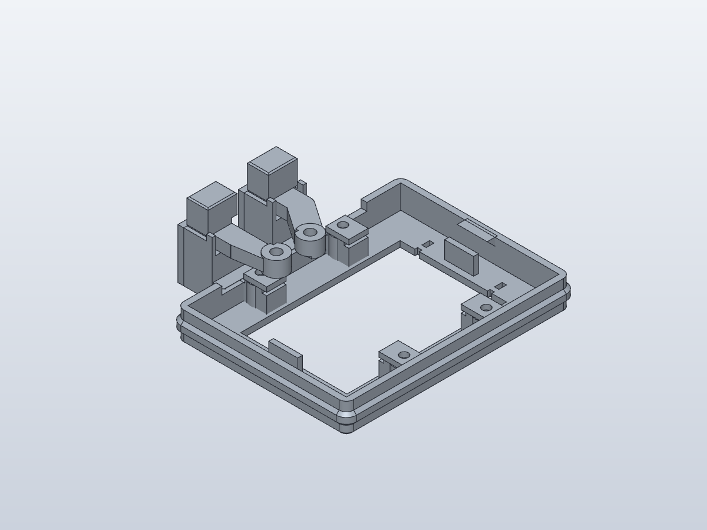

# Quick native fit prints

Start with **[replacements-only.3mf](replacements-only.3mf)** when reusing the
compatible revision 013/014 test frame and hardware. It contains the RESET slider,
BOOT slider and BOOT frame in their production print orientations. For a fresh
setup, use **[print-layout.3mf](print-layout.3mf)**: the registration frame, four
PCB clamps and both four-piece cartridges. Their native histories and individual
frame are included in this directory.

Use the [test 009 checklist](../../../../fit-tests/009-usb-clearance/README.md)
and [button assembly guide](../../../../assembly-guides/014-buttons/README.md).
Keep 100% scale, the intended final material/nozzle/layer height, and production
orientation. These geometry-only 3MF files do not supply slicer support settings.
Sliders need local support under their raised arms; keep it off sliding surfaces.

- Seat the actual board on the shelves; check bare-edge overlap, screw access and
  capture without crushing the PCB or touching soldered components.
- Fit the real USB plug, then install and adjust the button cartridges. Check
  insertion access, clearance through the complete stroke and at PCB movement
  limits, release at rest, and magnetic return.
- Support the PCB while inverting the jig and test press-up desk operation too.
- Record the printed revision, filament, settings, measurements and any binding
  before changing both the production part and its matching quick print.

The low frame omits the full-height walls, lid, desk bracket, central floor and
upper cable groove. It does not establish underside solder clearance, lid access,
whole-case stiffness or cable grip. For the retained cable-seat geometry, the
[existing cradle test](../../../../fit-tests/006-cable-cradle/README.md) remains
available. The [current native body](../parts/body.solidcraft) preserves the same
concave 8 mm cable seat and zip-tie passage. Physical results for this native
conversion remain pending.
